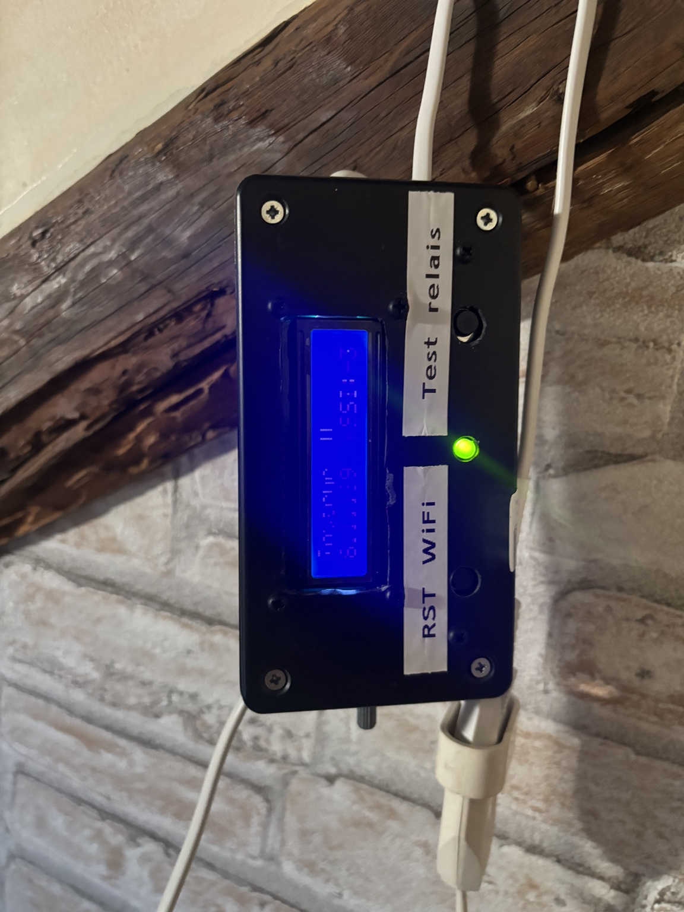

# Watchdog routeur 4G — ESP32

Un ESP32 surveille l'accès Internet d'un routeur 4G et peut redémarrer son alimentation par relais après une panne confirmée. Le boîtier installé à Saint-Clément-sur-Durance dispose d'un LCD 16×2, de boutons, d'une LED et d'une interface Web locale.

*ESP32 watchdog for a 4G router, with Internet checks, relay power cycling, LCD status and a local web interface.*

**Version actuellement installée et validée :** `WatchdogRouteur4G_V2_2_SAFE_OFF.ino`, testée à Saint-Clément-sur-Durance le **24 octobre 2026** sur ESP32 Dev Module avec LCD 16×2 parallèle. La variante I²C V2.3 reste **non testée**. Les photos existantes peuvent représenter des états antérieurs de l'installation.

## Trois firmwares distincts

| Fichier | LCD | OFF depuis le Web | État |
| --- | --- | --- | --- |
| [`WatchdogRouteur4GV3.ino`](firmware/WatchdogRouteur4GV3/WatchdogRouteur4GV3.ino) | Parallèle, 6 fils de commande | Pas de minuterie dédiée : la surveillance Internet ou un redémarrage de l'ESP32 peuvent le réalimenter ; durée non garantie | Ancienne version conservée pour historique |
| [`WatchdogRouteur4G_V2_2_SAFE_OFF.ino`](firmware/WatchdogRouteur4G_V2_2_SAFE_OFF/WatchdogRouteur4G_V2_2_SAFE_OFF.ino) | Parallèle, mêmes broches | Remise sous tension automatique après 5 min | **Stable — installée et validée le 24/10/2026** |
| [`WatchdogRouteur4G_V2_3_I2C_LCD_SAFE_OFF.ino`](firmware/WatchdogRouteur4G_V2_3_I2C_LCD_SAFE_OFF/WatchdogRouteur4G_V2_3_I2C_LCD_SAFE_OFF.ino) | I²C, SDA 21 / SCL 22 | Remise sous tension automatique après 5 min | Non testé sur site |

Le nom « V3 » est celui du fichier reçu ; son commentaire d'en-tête indique « V2 fiabilisée ». Les trois sources sont conservées **sans modification**. **La V2.2 SAFE OFF est la version de référence validée sur l'installation actuelle** ; la V2.3 I²C est une évolution matérielle non encore testée.

## Fonctionnement commun

- Test Internet HTTP toutes les **60 secondes** : Google 204, puis Cloudflare 204 en secours.
- **3 échecs consécutifs** après un état Internet précédemment confirmé provoquent une coupure du routeur de **10 secondes**, suivie d'une attente de démarrage de **90 secondes**. Il faut **2 succès consécutifs** pour rétablir l'état « Internet OK ».
- Limite par défaut de **48 redémarrages du routeur par jour**. Le compteur est conservé et réinitialisé au changement de jour lorsque l'heure NTP est valide.
- Interface Web locale : états, commandes du relais, configuration Wi-Fi et historique des événements. Affichage LCD alterné avec défilement des informations.
- Au démarrage de l'ESP32, le relais est placé en position **routeur alimenté** (`LOW`).

Le watchdog commande **l'alimentation du routeur**, pas le trafic réseau 4G.

## Câblage défini dans les sources

| Élément | Toutes les versions |
| --- | --- |
| Relais routeur | GPIO 16 : `LOW` = alimenté, `HIGH` = coupé |
| LED Internet | GPIO 23 |
| Bouton test/redémarrage routeur | GPIO 25 |
| Bouton reset Wi-Fi (appui d'environ 3 s) | GPIO 27 |

| LCD | V3 probable / V2.2 SAFE OFF | V2.3 I²C |
| --- | --- | --- |
| Connexions | RS 13, E 12, D4 14, D5 32, D6 33, D7 26 | SDA 21, SCL 22 ; adresse `0x27` dans le code |
| Rétroéclairage | Écran parallèle existant | Bouton GPIO 26 vers GND : réveil du rétroéclairage pendant 3 min |

**Ne pas flasher la variante I²C sur le montage câblé pour le LCD parallèle sans adapter le matériel.** Vérifier le comportement du relais avant de brancher le routeur.

## Photos de l'installation actuelle

[Boîtier installé](images/watchdog-installed-wide.jpeg) · [Routeur 4G](images/router-4g.jpeg) · [État Web](images/web-status.jpeg) · [Historique Web](images/web-history.png)

Ces captures illustrent l'installation. La validation de la temporisation SAFE OFF de la V2.2 est documentée ci-dessous ; la V2.3 I²C reste à tester.

## Ouvrir un sketch

Chaque `.ino` est placé dans un dossier de même nom pour l'ouvrir dans l'IDE Arduino. Les versions à LCD parallèle utilisent `LiquidCrystal.h` ; la variante I²C utilise `Wire.h` et `LiquidCrystal_I2C.h`. Toutes utilisent `WiFi.h`, `HTTPClient.h`, `Preferences.h`, `AsyncTCP.h` et `ESPAsyncWebServer.h` avec le support ESP32 pour Arduino.

Au premier démarrage sans identifiants enregistrés, l'ESP32 crée le point d'accès `ESP32_Config`. **Changer son mot de passe par défaut défini dans chaque sketch avant une nouvelle installation.** Les commandes de l'interface Web fournie n'ont pas d'authentification ; réserver son accès au réseau local ou à un accès privé maîtrisé.

## Validation sur site — V2.2 SAFE OFF (24 octobre 2026)

- Matériel : **ESP32 Dev Module**, LCD 16×2 **parallèle** ; interface Web accessible sur le réseau local.
- **13:08:29** — Connexion Wi-Fi après flash ; **13:10:27** — Internet redevenu OK (stable), d'après les journaux.
- **20:10:59** — Commande « 4G OFF » depuis l'interface Web, avec remise ON programmée à cinq minutes.
- **20:15:59** — Journal : « SÉCURITÉ : remise ON automatique après 5 min de OFF Web ».
- Après la coupure, le routeur a redémarré et l'accès Internet a été retrouvé ; compteur de reboots affiché **0/48**, sans redémarrage automatique intempestif constaté durant cet essai.

**Conclusion : V2.2 SAFE OFF validée en conditions réelles pour la coupure Web temporisée et le rétablissement de l'accès.** Cette validation ne remplace pas un test exhaustif de toutes les situations de panne.

## Essais restant à réaliser

1. Sur la **V2.3 I²C**, confirmer le câblage, l'adresse I²C, l'affichage et l'extinction/réveil du rétroéclairage après trois minutes.
2. Sur les versions futures, revalider le comportement du relais au démarrage et le retour automatique après une coupure Web.
3. Compléter les essais de panne Internet prolongée, du limiteur quotidien et des journaux sur la version publiée.

Le schéma de câblage éditable reste à ajouter avant de présenter le projet comme entièrement reproductible.

## Licence

Code et documentation : **GNU GPLv3**, comme le projet Fibre → 4G. Copyright © 2026 Serge HAAS. Voir [LICENSE](LICENSE).
